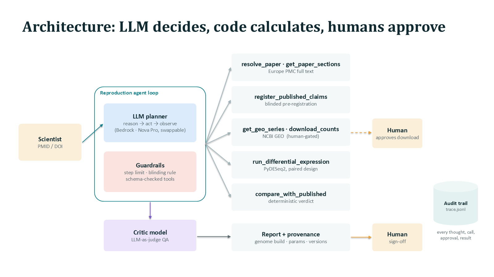

# Literature-to-Analysis Agent

**An AI agent that re-runs a published bioinformatics analysis from public data and tells you, in about
75 seconds, whether the paper's findings hold up, and why not if they don't.**

> Before we build on a published result, someone has to check it's real. Done by hand, that takes a
> bioinformatician days. This agent does the mechanical work, and a human reviews the evidence and signs off.

**Demo result:** Himes et al. 2014 (PMID 24926665) → **REPRODUCED, 12 of 12 published gene claims confirmed.**

---

## 1. Why this matters

### Why scientists read papers in the first place

Papers aren't read for curiosity. Each one feeds a decision:

| Goal | What the paper provides |
|---|---|
| **Choose or validate a drug target** | Evidence that a gene drives a disease or responds to a drug |
| **Find biomarkers** | Genes that indicate disease state or treatment response |
| **Reuse public data** | Datasets (in NCBI GEO) that anyone can re-analyse |
| **Build gene signatures** | "These genes go up when X happens", used to compare with internal experiments |
| **Pick methods and models** | Which cells, doses, pipelines and statistics others used |
| **Generate hypotheses** | Links between drugs, genes and diseases across studies |

### The problem: a lot of published biology doesn't hold up

- **Amgen** could confirm only **6 of 53** landmark cancer studies (Begley & Ellis, *Nature* 2012).
- **Bayer** found in-house results matched published data in only **~20–25%** of projects (Prinz et al., 2011).

Acting on a finding that doesn't hold up can waste months of lab work. So before trusting a paper, a
bioinformatician re-does it by hand:

1. Read the methods (often vague)
2. Find the dataset the authors used
3. Guess their settings (genome version, software, thresholds)
4. Re-run the analysis
5. Compare results and work out why they differ

**That takes days of expert time per paper, spent on mechanics rather than science.**

### What the agent changes

| | Manual | With the agent |
|---|---|---|
| Time per paper | Days | ~75 seconds, plus human review |
| Consistency | Depends on the person and the paper | Same checks and documentation every time |
| Record of how | Notes, if any | Full audit trail of every step |
| Expert's role | Doing the reproduction | Reviewing the evidence |

---

## 2. How it works



### Reading the diagram

- **Bioinformatician (left):** the only input is a paper ID (PMID or DOI).
- **Reproduction Agent (the brain):**
  - **LLM planner:** the AI decides what to do next. It reasons, calls a tool, observes the result, and
    repeats until done. The model is swappable: Amazon Bedrock today, Claude or Gemini with one setting.
  - **Guardrails:** every AI action passes through safety rules: a step limit, a blinding rule (no
    analysis until the paper's claims are locked) and validated tool inputs.
- **Tools (the hands):** the AI can only act through five tools. Each is an ordinary Python function
  with a defined input schema, the same format MCP uses, so other agents and platforms can reuse them.
- **Humans (yellow boxes):** a person approves the data download and signs off the result.
- **Critic model:** a second AI checks every number in the report against the raw tool outputs, like a
  peer reviewer.
- **Report + provenance:** records the dataset, genome version, settings and software versions used.
- **Audit trail:** every thought, tool call, approval and result is logged, so any conclusion can be traced.

### Three design principles

1. **It does real work.** It reads the paper, downloads the real data and runs standard statistics. It
   doesn't just summarise text.
2. **The AI decides, code calculates.** The LLM makes judgment calls (which samples, which comparison,
   which claims). Every number and the final verdict come from code.
3. **It's governed.** Claims are locked before data is seen, humans approve at two points, a critic
   checks the report, and everything is logged.

---

## 3. Walkthrough on the demo paper

**The paper:** Himes et al., *PLoS One* 2014, PMID **24926665**. Airway smooth muscle cells from
**4 donors** were treated with **dexamethasone** (a steroid, the drug class in asthma inhalers) and
profiled by RNA-seq. The authors report **316 changed genes** and identify **CRISPLD2** as a new
steroid-responsive gene. It's a well-known benchmark: this is the "airway" dataset used in
Bioconductor's RNA-seq tutorials.

| Step | What happens | In | Out |
|---|---|---|---|
| **1. Read** | Pulls full text from **Europe PMC**, EMBL-EBI's free mirror of PubMed/PMC | PMID 24926665 | Methods, Results, and 3 dataset IDs mentioned (GSE13168, GSE34313, GSE52778) |
| **2. Lock the claims** | **Blinded pre-registration**, borrowed from clinical trials: write down what the paper claims *before* seeing data. Code rejects gene names not found in the paper. | 12 genes with direction, 316 genes, FDR 0.05 | Claims locked. (In one run the AI tried an outdated gene name, `C13orf15`; it was rejected.) |
| **3. Understand the data** | Reads sample labels in **NCBI GEO**, the public gene-expression repository. GSE = study, GSM = sample. | GSE52778 | 16 samples = 4 donors × 4 treatments. The agent picks the 8 relevant ones, drops the unrelated albuterol arms, and **chooses a paired design by donor on its own**. |
| **4. Get the data** | NCBI re-processes public RNA-seq uniformly (aligned to the **GRCh38** genome, reads counted per gene). **A human approves the download.** | GSE52778 + approval | Count matrix: 39,376 genes × 16 samples |
| **5. Re-analyse** | **DESeq2**, the standard RNA-seq statistics (Python version, PyDESeq2) | Untreated vs Dexamethasone, paired by donor | 21,833 genes tested, 4,552 significant |
| **6. Score** | Fixed rule in code: ≥80% of claims confirmed = reproduced, ≥50% = partial, otherwise not reproduced | Locked claims + results | **REPRODUCED, 12/12** |
| **7. Explain** | Classifies each difference as TECHNICAL or a possible genuine discrepancy | Both results | See below |
| **8. QA + sign-off** | Critic model reviews; a person approves | Report + raw outputs | `report.md`, audit trail, signed decision |

### Key terms

- **log2 fold change:** +1 = doubled, +2 = 4×, −1 = halved.
- **padj (FDR):** p-value corrected for testing ~20,000 genes at once. Below 0.05 = significant.
- **Paired design:** each donor is compared with itself, removing donor-to-donor differences (more power).
- **Genome build:** the reference human genome has versions. **hg19** (2009) and **GRCh38** (2013) differ
  in coordinates and gene annotations. This is the most common cause of false discrepancies.

### Why 4,552 genes when the paper found 316?

The paper used 2014-era software (Cuffdiff) on the older genome (hg19). The agent used DESeq2 with a paired
design on GRCh38, which is more sensitive, so more genes pass the cut-off. **The key genes and their effect
sizes match closely**, so the agent classifies this as a **TECHNICAL** difference, not a contradiction.
Telling those two apart is exactly what a human reviewer needs.

---

## 4. Governance built in

| Risk | How the design handles it |
|---|---|
| AI invents numbers | Every statistic and the verdict come from code, never from the model |
| Cherry-picking results | Claims are locked before analysis; genes not in the paper are rejected |
| Uncontrolled actions | Human approval before external downloads; a hard step limit |
| Overstated conclusions | An independent critic model checks the report against raw outputs |
| Can't explain a result | Full provenance plus an append-only audit trail per run |
| Result used without review | Nothing is final until a person signs off |

**Pilot caveat:** runs on a personal AWS account (Amazon Bedrock, which doesn't train on prompts) with
**public data only**. Internal data requires an approved enterprise account and an AI Registry check.

### What it is not

- It doesn't make new biological discoveries. It only checks what a paper already claims.
- It doesn't replace the bioinformatician. A person approves every result.
- It isn't proven at scale yet: one benchmark paper so far.

---

## 5. How this scales

### From one paper to target decisions

| Stage | What it adds | Value |
|---|---|---|
| **A. More papers** | Take a list or a search query, keep papers that are open access with a GEO dataset, run them in a batch | Check every paper a team cites |
| **B. Independent datasets** | Test a claim in *other* datasets, not just the original (e.g. GSE13168 and GSE34313 from the same paper) | **Reproduction** checks the analysis; **replication** checks the biology, which is much stronger evidence |
| **C. Target evidence dossier** | Input a gene (e.g. CRISPLD2) instead of a paper: find all papers and datasets, test each, summarise | "Supported in 5 of 6 independent datasets": what a target-validation team needs |
| **D. Signature library** | Store the gene lists from every reproduced analysis | Compare internal experiments against validated public signatures |

### Roadmap

| When | Focus |
|---|---|
| **Weeks 0–2** | Run 3–5 of our own backlog papers, including one expected to fail. Build a benchmark set with known verdicts. |
| **Days 15–45** | Raw-read re-alignment (nf-core/rnaseq on AWS HealthOmics), microarray support (limma), single-cell (Scanpy) |
| **Days 45–75** | Host on Bedrock AgentCore, tools as MCP servers, Claude on an enterprise account. Shadow mode alongside analysts. |
| **Days 75–90** | Controlled go-live: Teams approvals, owners assigned, KPI review at 30/60/90 days |

### Making it resilient

| Area | Tools |
|---|---|
| Reliable data access | NCBI API key (3→10 requests/s), `requests-cache`, `tenacity` retries |
| Better claim extraction | Gene alias mapping (MyGene.info / HGNC), PubTator3 gene annotations |
| Quality control | Benchmark set run on every change, `pytest` with recorded HTTP responses, `pydantic` validation |
| Batch runs | Resumable batch runner → AWS Step Functions + SQS |
| Heavy compute | nf-core/rnaseq on AWS HealthOmics or AWS Batch, Docker, pinned dependencies |
| Production | Bedrock AgentCore (runtime, gateway, observability), AWS Secrets Manager, GitHub Actions |

### Tech stack: pilot vs production

| Layer | Pilot (built) | Production option |
|---|---|---|
| LLM | Amazon Bedrock (Nova Pro), Gemini as fallback | Claude on enterprise Bedrock, Copilot Studio or Cortex |
| Agent runtime | Custom Python loop, provider-swappable | Bedrock AgentCore Runtime or Copilot Studio |
| Tools | Python registry with JSON schemas | Same contracts as MCP tools (AgentCore Gateway) |
| Literature | Europe PMC REST API (full text) | Plus internal library / licensed journals |
| Data | NCBI GEO reprocessed counts | nf-core/rnaseq from raw reads (any genome build) |
| Statistics | PyDESeq2 (paired designs) | Plus Scanpy (single-cell), limma (arrays) |
| UI + approvals | Streamlit, sign-off button | Teams adaptive cards, SharePoint reports |
| Audit | `trace.jsonl` per run | AgentCore Observability, AI Registry evidence |

---

## 6. Decisions for the team

1. How many papers do we validate per month? (the ROI baseline)
2. Feasibility scores for the assessment table
3. Platform: Python + enterprise LLM, Claude.ai, or Copilot Studio?
4. Which 3–5 backlog papers to test first?
5. Who owns the AI Registry check and genome-version drift monitoring?

**The ask:** two weeks and 3–5 of our own papers, with no infrastructure spend, to see if it holds up on real work.

---

## 7. Running it

```
python -m venv venv
venv\Scripts\activate
pip install -r requirements.txt
copy .env.example .env                   # then fill in keys
streamlit run app.py                     # demo UI at http://localhost:8501
python run_agent.py 24926665             # command line, asks y/N at the download gate
python run_agent.py 24926665 --yes       # unattended
```

### LLM providers (`LLM_PROVIDER` in `.env`)

| Provider | Settings | Notes |
|---|---|---|
| `bedrock` (default) | `AWS_BEARER_TOKEN_BEDROCK` (or `aws configure` credentials), `AWS_REGION`, `BEDROCK_MODEL` | Converse API. `us.amazon.nova-pro-v1:0` works on most accounts; Claude models need account-level access. ~75 s per run. |
| `gemini` | `GEMINI_API_KEY`, optional `GEMINI_MODEL`, `GEMINI_FALLBACK_MODELS` | Free tier is rate-limited; runs can take ~10 min. |

Short-term Bedrock API keys expire within 12 hours; regenerate before a live demo.

### Demo steps

1. **Live run** with `24926665` (~75 s). Backup: sidebar → **Replay a recorded run** → `DEMO-himes2014-bedrock-nova`.
2. While it runs, point out: claims locked before data, the agent choosing samples and a paired design, the human gate.
3. **Results & sign-off** tab: verdict, per-gene table, volcano plot (the paper's genes in red), then type a name and click **Approve**.
4. Optional: turn off *Approve external data download* to show the agent stopping at the gate.

### Useful links

| What | Link |
|---|---|
| The paper (PubMed) | https://pubmed.ncbi.nlm.nih.gov/24926665/ |
| Full text (PMC), see Table 1 | https://pmc.ncbi.nlm.nih.gov/articles/PMC4057123/ |
| Europe PMC API (what the agent reads) | https://www.ebi.ac.uk/europepmc/webservices/rest/search?query=EXT_ID:24926665&format=json |
| GEO dataset | https://www.ncbi.nlm.nih.gov/geo/query/acc.cgi?acc=GSE52778 |
| One GEO sample | https://www.ncbi.nlm.nih.gov/geo/query/acc.cgi?acc=GSM1275863 |
| NCBI-generated counts | https://www.ncbi.nlm.nih.gov/geo/download/?acc=GSE52778 |

### Project layout

| Path | What |
|---|---|
| `lit2analysis/agent.py` | Agent loop (reason → act → observe), provider backends, approval hook, audit trail |
| `lit2analysis/pipeline.py` | System prompt, critic, report + provenance |
| `lit2analysis/tools/` | Tools: Europe PMC, NCBI GEO, PyDESeq2, comparison |
| `app.py` | Streamlit UI: live run, replay, results, volcano plot, sign-off, architecture |
| `runs/DEMO-*/` | Recorded runs for offline replay |
| `presentation/` | Slide deck and presenter guide |

### Known limits

- Bulk RNA-seq with NCBI-reprocessed counts (human/mouse) only, for now.
- Needs open-access full text and a GEO dataset; otherwise the agent stops and says why.
- Gene symbols come from NCBI `gene_info`, because GEO's own annotation file is behind a captcha.
- Never commit `.env`; it's in `.gitignore`. Use `.env.example` as the template.
